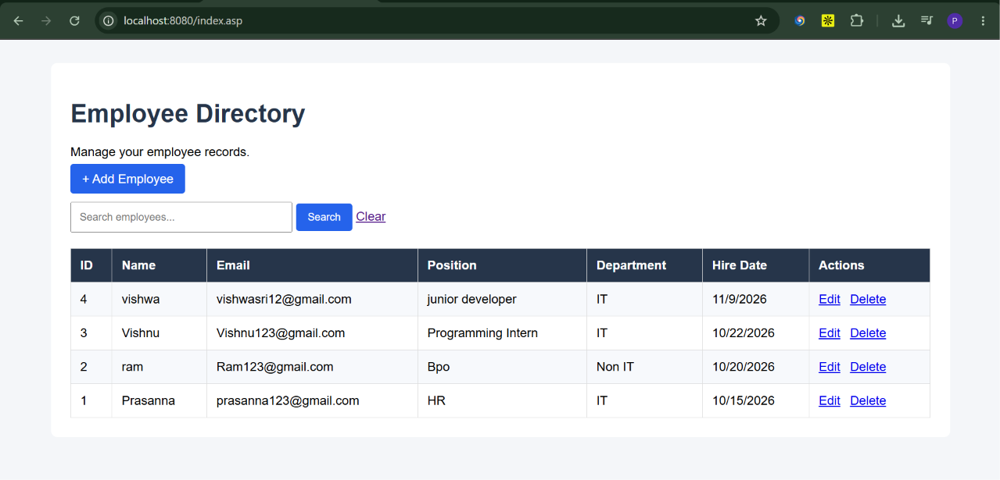
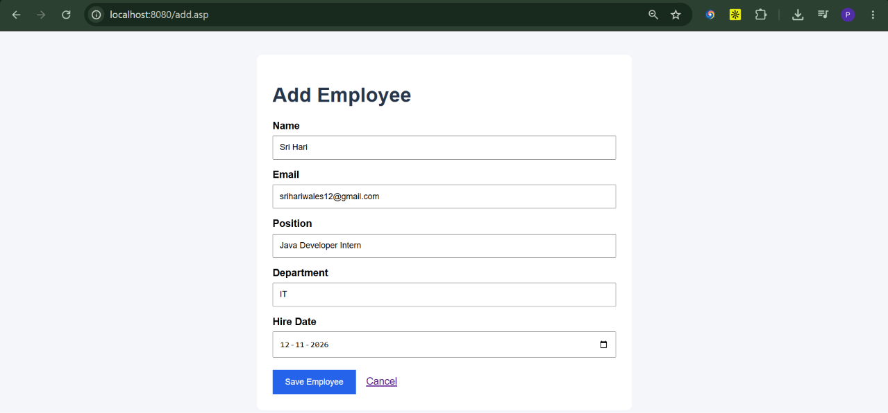
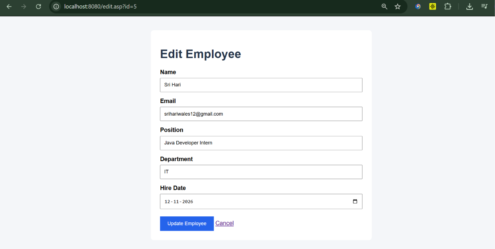
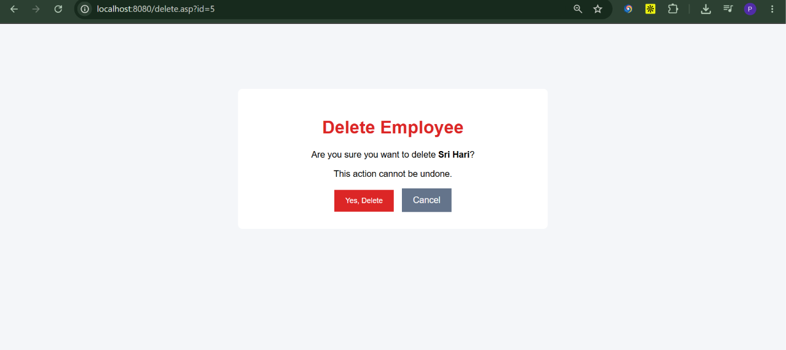

# Employee Directory – Classic ASP

## 1. Project Overview

The Employee Directory is a full-stack web application developed using Classic ASP and VBScript, with HTML, CSS and JavaScript for the user interface.

The application allows users to manage employee information through Create, Read, Update and Delete (CRUD) operations.

## 2. Technologies Used

| Technology | Purpose |
|---|---|
| Classic ASP | Server-side application |
| VBScript | Server-side scripting |
| HTML5 | Page structure |
| CSS3 | User interface design |
| JavaScript | Client-side validation |
| Microsoft SQL Server | Database management |
| ADO | Database connectivity |
| Microsoft OLE DB Driver 19 | SQL Server connection |
| IIS | Web server |

## 3. Project Structure

```text
Task 8 - Classic ASP/
│
├── db.asp
├── index.asp
├── add.asp
├── edit.asp
├── delete.asp
├── EmployeeDirectory.sql
├── README.md
└── Screenshots/
    ├── 01-Employee-List.png
    ├── 02-Add-Employee.png
    ├── 03-Edit-Employee.png
    └── 04-Delete-Confirmation.png
```

## 4. Prerequisites

Install the following software before running the project:

- Windows operating system
- Microsoft SQL Server
- SQL Server Management Studio (SSMS)
- Internet Information Services (IIS)
- Classic ASP IIS feature
- Microsoft OLE DB Driver 19 for SQL Server
- Web browser (Google Chrome or Microsoft Edge)

## 5. Database Setup

### Database Details

Database Name: `InternTraining`

Table Name: `dbo.Employees`

| Column | Data Type | Constraint |
|---|---|---|
| EmployeeID | INT | Primary Key, Identity |
| Name | NVARCHAR(100) | NOT NULL |
| Email | NVARCHAR(254) | NOT NULL, UNIQUE |
| Position | NVARCHAR(100) | NOT NULL |
| Department | NVARCHAR(100) | NOT NULL |
| HireDate | DATE | NOT NULL |

### How to Set Up the Database

1. Open SQL Server Management Studio.
2. Connect to your SQL Server instance.
3. Open the `EmployeeDirectory.sql` file.
4. Select the `InternTraining` database, if it already exists.
5. Execute the SQL script.
6. Verify that the `dbo.Employees` table exists.

The SQL script checks for the existing table before creating it, so existing employee records are preserved.

## 6. Database Connection Configuration

The application uses ADO (ActiveX Data Objects) to connect to SQL Server.

The connection is configured in `db.asp`.

Database configuration:

- Server: `PRASANNA\SQLEXPRESS`
- Database: `InternTraining`
- Provider: Microsoft OLE DB Driver 19
- Authentication: Windows Authentication

The application pool identity must have the required SQL Server permissions to read and modify employee records.

Update the server instance in `db.asp` according to the local development environment.

## 7. Application Features

### 7.1 Employee List – Read

- Displays all employee records.
- Shows employee ID, name, email, position, department and hire date.
- Provides search functionality.
- Provides Edit and Delete actions.

### 7.2 Add Employee – Create

- Provides an employee registration form.
- Collects name, email, position, department and hire date.
- Performs client-side and server-side validation.
- Inserts employee records into SQL Server.

### 7.3 Edit Employee – Update

- Retrieves employee details using EmployeeID.
- Displays existing employee information.
- Allows modification of employee details.
- Updates the database using a parameterized SQL query.

### 7.4 Delete Employee – Delete

- Displays the selected employee information.
- Provides a confirmation before deletion.
- Deletes the selected employee record after confirmation.

### 7.5 Search Employees

- Allows searching by employee name, email, position or department.
- Uses parameterized SQL queries to filter records.

## 8. Validation and Security

### Client-Side Validation

JavaScript validation is used to:

- Check required fields.
- Validate email format.
- Prevent incomplete form submissions.

### Server-Side Validation

VBScript validation is used to:

- Verify required employee information.
- Validate email format.
- Check the hire date.
- Prevent invalid form submissions.

### SQL Injection Prevention

Database operations use the ADO Command Object with parameterized SQL queries.

SQL values are passed through parameters rather than concatenated into SQL statements.

### Output Encoding

`Server.HTMLEncode` is used when displaying database values to help prevent HTML injection and cross-site scripting.

## 9. Error Handling

The application should handle common errors gracefully, including:

- Missing or invalid employee information.
- Duplicate email addresses.
- Invalid employee IDs.
- Employee records that cannot be found.
- Database connection failures.
- SQL query execution failures.

Database operations should check for ADO errors, display user-friendly messages and release database objects properly.

Detailed database and server errors should not be exposed to end users in a production environment.

## 10. IIS Deployment

### Step 1: Enable IIS Features

Enable the following Windows features:

- Internet Information Services
- World Wide Web Services
- Application Development Features
- ASP
- ISAPI Extensions
- ISAPI Filters

### Step 2: Create the Website

1. Open IIS Manager using `inetmgr`.
2. Right-click Sites.
3. Select Add Website.
4. Enter the website name: `EmployeeDirectoryClassicASP`.
5. Select the Task 8 - Classic ASP folder as the physical path.
6. Configure the port as `8080`.
7. Click OK.

### Step 3: Configure Default Document

1. Select the website in IIS Manager.
2. Open Default Document.
3. Add `index.asp` if it is not listed.

### Step 4: Configure Classic ASP

1. Open the ASP feature.
2. Enable Parent Paths only if the application uses parent-directory paths such as `../`.
3. Ensure the application has the appropriate folder permissions.

The application-pool identity requires Read and Execute permissions on the project folder and its files.

### Step 5: Configure Authentication and Database Permissions

1. Open Authentication in IIS.
2. Edit Anonymous Authentication.
3. Select Application Pool Identity.
4. Grant the application-pool identity the required SQL Server login and database permissions.

### Step 6: Run the Website

Start the website in IIS Manager.

Open the following URL:

`http://localhost:8080/`

## 11. Visual Verification

The following screenshots demonstrate the application's functional states.


## 11. Visual Verification

### 11.1 Employee List View



### 11.2 Add Employee Form



### 11.3 Edit Employee Form



### 11.4 Delete Confirmation




## 12. Testing

The following operations were tested:

- Employee listing and retrieval
- Adding employee records
- Updating existing employee records
- Deleting employee records
- Searching employee records
- Client-side form validation
- Server-side form validation
- SQL Server database connectivity

## 13. Conclusion

The Employee Directory project demonstrates the implementation of a Classic ASP application with VBScript, SQL Server integration, CRUD operations, search functionality, validation and parameterized database queries.